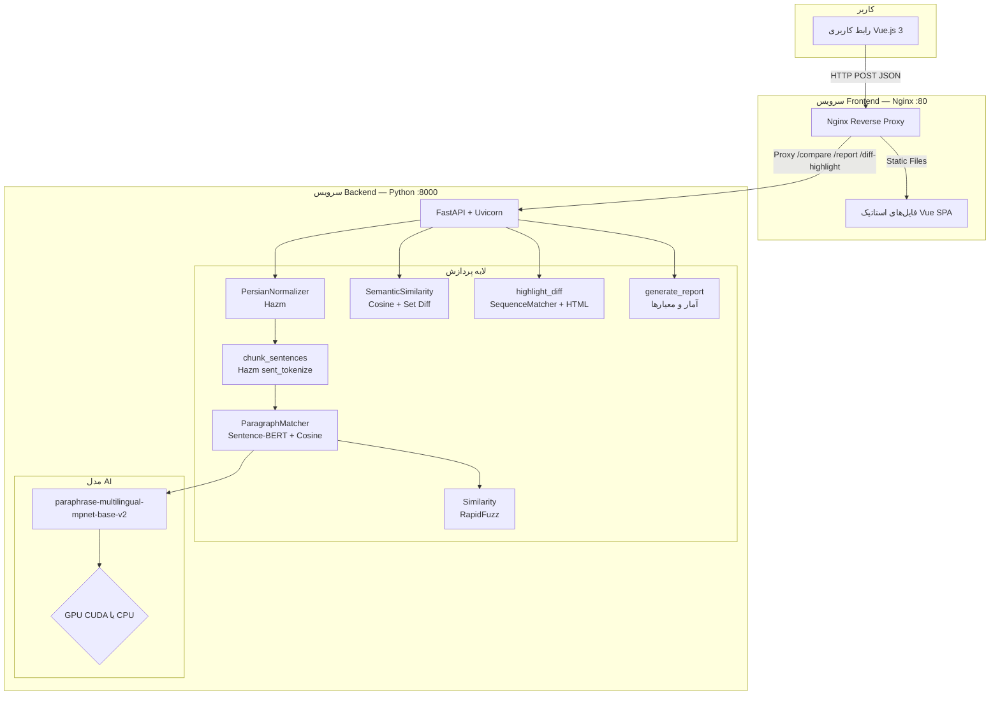
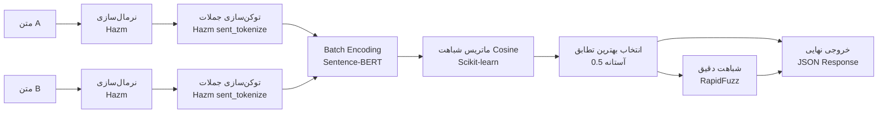
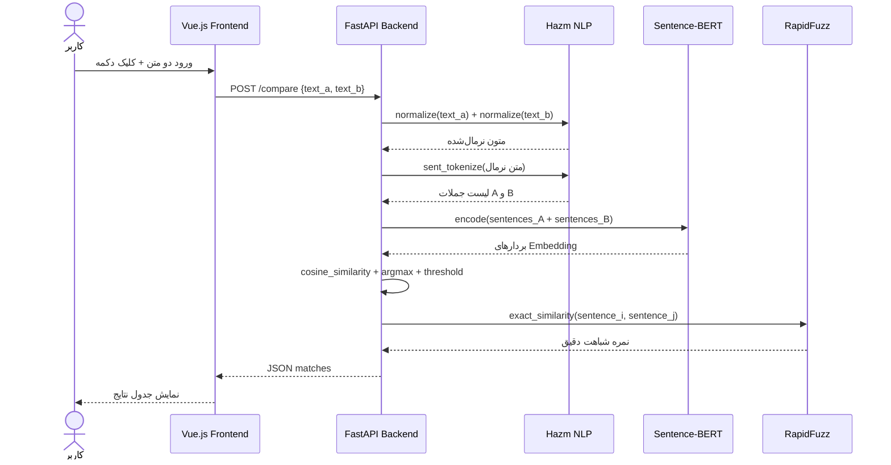

<div dir="rtl">

# 🦇 Batman — سامانه تشخیص شباهت نصوص

> بستری هوشمند برای تحلیل معنایی، تشخیص تشابه و کشف سرقت ادبی در متون فارسی

<div align="center">


</div>

---

## 📑 فهرست مطالب

- [معرفی پروژه](#-معرفی-پروژه)
- [فناوری‌های استفاده‌شده](#-فناوری‌های-استفاده‌شده)
- [معماری سیستم](#-معماری-سیستم)
- [قابلیت‌های سامانه](#-قابلیت‌های-سامانه)
- [الگوریتم‌ها و روند پردازش](#-الگوریتم‌ها-و-روند-پردازش)
- [ساختار پوشه‌ها و فایل‌ها](#-ساختار-پوشه‌ها-و-فایل‌ها)
- [نحوه نصب و راه‌اندازی](#-نحوه-نصب-و-راه‌اندازی)
- [تنظیمات مورد نیاز](#-تنظیمات-مورد-نیاز)
- [راهنمای اجرا](#-راهنمای-اجرا)
- [مستندات API](#-مستندات-api)
- [نمونه ورودی و خروجی](#-نمونه-ورودی-و-خروجی)
- [محدودیت‌های فعلی](#-محدودیت‌های-فعلی)
- [پیشنهادهای توسعه آینده](#-پیشنهادهای-توسعه-آینده)
- [جمع‌بندی](#-جمع‌بندی)

---

## 🎯 معرفی پروژه

### هدف پروژه

**Batman** یک سامانه دانشگاهی در حوزه پردازش زبان طبیعی (NLP) است که با هدف **تشخیص شباهت معنایی و کلمه‌به‌کلمه میان دو متن فارسی** طراحی و پیاده‌سازی شده است. این سامانه قادر است دو متن ورودی را در سطح جمله تحلیل کرده، میزان تشابه معنایی و ظاهری آن‌ها را محاسبه نماید و گزارشی جامع از احتمال سرقت ادبی ارائه دهد.

### بیان مسئله

با گسترش تولید محتوای دیجیتال، اطمینان از **اصالت متون** به یک چالش جدی تبدیل شده است. روش‌های سنتی تشخیص تشابه، صرفاً بر اساس تطابق رشته‌ای (string matching) عمل می‌کنند و از درک معنای جملات عاجزند. به همین دلیل، متونی که با بازنویسی، ترادف‌گذاری یا تغییر ساختار نگارشی تهیه می‌شوند، از چشم این سیستم‌ها پنهان می‌مانند.

این پروژه با بهره‌گیری از مدل‌های **یادگیری عمیق چندزبانه** و تکنیک‌های پیشرفته NLP، این خلأ را پر کرده و قادر است تشابه معنایی را فراتر از تطابق لغوی شناسایی کند.

### اهمیت موضوع

- **محیط‌های دانشگاهی:** تشخیص سرقت ادبی در پایان‌نامه‌ها، مقالات و گزارش‌های علمی
- **ناشران و رسانه‌ها:** بررسی اصالت محتوای منتشرشده
- **سیستم‌های قضایی و حقوقی:** مقایسه اسناد و قراردادها
- **پلتفرم‌های آموزشی:** ارزیابی اصالت تکالیف دانشجویان

### کاربردهای سامانه

| کاربرد               | توضیح                                        |
| -------------------- | -------------------------------------------- |
| **تشخیص سرقت ادبی**  | شناسایی محتوای کپی‌شده یا بازنویسی‌شده       |
| **مقایسه نسخ اسناد** | یافتن تفاوت‌های معنایی بین دو نسخه از یک سند |
| **تحلیل محتوا**      | ارزیابی میزان همپوشانی موضوعی دو متن         |
| **بررسی ترجمه**      | مقایسه متن اصلی با ترجمه در سطح معنایی       |

---

## 🛠 فناوری‌های استفاده‌شده

### ۱. Python 3.10

**کاربرد:** زبان اصلی پیاده‌سازی Backend  
**دلیل انتخاب:** اکوسیستم غنی کتابخانه‌های NLP و یادگیری ماشین، سادگی کد، و پشتیبانی گسترده از ابزارهای هوش مصنوعی  
**تعامل:** تمام ماژول‌های پردازشی، مدل‌های یادگیری ماشین و سرویس API در Python پیاده‌سازی شده‌اند

### ۲. FastAPI

**کاربرد:** فریم‌ورک ساخت RESTful API در سمت Backend  
**دلیل انتخاب:** عملکرد بالا (مبتنی بر ASGI)، تولید خودکار مستندات Swagger، اعتبارسنجی داده با Pydantic، و پشتیبانی native از async  
**تعامل:** سه endpoint اصلی (`/compare`، `/report`، `/diff-highlight`) را در معرض دسترسی Frontend قرار می‌دهد

### ۳. Sentence-Transformers — paraphrase-multilingual-mpnet-base-v2

**کاربرد:** تبدیل جملات به بردارهای عددی (Sentence Embedding) برای محاسبه شباهت معنایی  
**دلیل انتخاب:** این مدل به‌صورت چندزبانه آموزش دیده و از زبان فارسی پشتیبانی می‌کند. معماری `mpnet-base` دقت بالایی در تشخیص معنای جملات دارد  
**تعامل:** هر دو متن ورودی به صورت batch به این مدل داده می‌شوند و بردارهای حاصل برای محاسبه ماتریس شباهت cosine استفاده می‌گردند

### ۴. Hazm

**کاربرد:** پردازش زبان طبیعی اختصاصی زبان فارسی (نرمال‌سازی و توکن‌سازی)  
**دلیل انتخاب:** تنها کتابخانه بومی و بالغ برای NLP فارسی با پشتیبانی از نیم‌فاصله، ویرایش اعداد و نرمال‌سازی حروف  
**تعامل:** پیش از هرگونه پردازش، متن ورودی از طریق `PersianNormalizer` نرمال و سپس توسط `sent_tokenize` به جملات مجزا تقسیم می‌شود

### ۵. PyTorch

**کاربرد:** موتور محاسباتی زیرین برای اجرای مدل‌های یادگیری عمیق  
**دلیل انتخاب:** کتابخانه استاندارد برای اجرای مدل‌های Hugging Face و Sentence-Transformers  
**تعامل:** در صورت وجود GPU، سامانه به‌صورت خودکار از CUDA استفاده می‌کند؛ در غیر این صورت روی CPU اجرا می‌شود

### ۶. Scikit-learn

**کاربرد:** محاسبه ماتریس شباهت Cosine بین embedding های جملات  
**دلیل انتخاب:** پیاده‌سازی بهینه و بردارسازی‌شده `cosine_similarity` برای عملیات ماتریسی  
**تعامل:** در `matcher.py` و `semantic.py` برای محاسبه سریع شباهت بین تمامی جفت جملات به کار می‌رود

### ۷. RapidFuzz

**کاربرد:** محاسبه شباهت دقیق رشته‌ای (Exact String Similarity) بر اساس نسبت ویرایشی  
**دلیل انتخاب:** پیاده‌سازی بسیار سریع‌تر از `difflib` با الگوریتم Levenshtein بهینه‌شده  
**تعامل:** در `similarity.py` برای محاسبه `exact_similarity` جفت جملات تطبیق‌یافته استفاده می‌شود

### ۸. difflib — کتابخانه استاندارد Python

**کاربرد:** تشخیص تفاوت‌های ظاهری در سطح کلمه بین دو متن با `SequenceMatcher`  
**دلیل انتخاب:** موجود در کتابخانه استاندارد Python بدون نیاز به وابستگی خارجی؛ مناسب برای تولید diff کلمه‌به‌کلمه  
**تعامل:** در `highlight.py` برای تولید HTML annotated diff با برچسب‌گذاری مناطق تغییر، حذف و اضافه استفاده می‌شود

### ۹. Vue.js 3 — Composition API

**کاربرد:** فریم‌ورک ساخت رابط کاربری تعاملی (SPA)  
**دلیل انتخاب:** معماری Composition API انعطاف‌پذیری بیشتری در مدیریت state دارد؛ چرخه توسعه سریع با Vite  
**تعامل:** از طریق Axios با Backend ارتباط برقرار می‌کند و خروجی HTML دریافتی از `/diff-highlight` را به‌صورت مستقیم رندر می‌کند

### ۱۰. Vite

**کاربرد:** ابزار Build و Dev Server برای Frontend  
**دلیل انتخاب:** سرعت بسیار بالا در hot-reload، پشتیبانی native از Vue 3  
**تعامل:** در محیط توسعه، درخواست‌های API را به‌صورت Proxy به Backend ارسال می‌کند

### ۱۱. TailwindCSS

**کاربرد:** فریم‌ورک CSS برای طراحی رابط کاربری  
**دلیل انتخاب:** رویکرد utility-first برای طراحی سریع و سازگار  
**تعامل:** در کنار CSS سفارشی تعریف‌شده در `main.css` برای استایل‌دهی کامپوننت‌ها به کار می‌رود

### ۱۲. Axios

**کاربرد:** کلاینت HTTP در Frontend برای ارتباط با Backend API  
**دلیل انتخاب:** API ساده و promise-based، پشتیبانی خودکار از JSON، مدیریت ساده خطاها  
**تعامل:** در `api/index.js` سه تابع مجزا برای هر endpoint تعریف شده‌اند

### ۱۳. Nginx

**کاربرد:** وب‌سرور و Reverse Proxy در محیط Production  
**دلیل انتخاب:** کارایی بالا برای سرویس‌دهی فایل‌های استاتیک  
**تعامل:** درخواست‌های `/compare`، `/report`، `/diff-highlight` را به Backend ارسال کرده و سایر مسیرها را به `index.html` هدایت می‌کند (SPA fallback)

### ۱۴. Docker و Docker Compose

**کاربرد:** کانتینرسازی و استقرار یکپارچه سامانه  
**دلیل انتخاب:** استقرار قابل تکرار و مستقل از محیط اجرا  
**تعامل:** دو سرویس `backend` و `frontend` با شبکه داخلی Docker به هم متصل هستند

---

## 🏗 معماری سیستم

### نمودار معماری کلی



### نمودار جریان داده



### نمودار تعامل اجزا



---

## ✨ قابلیت‌های سامانه

### ۱. مقایسه جملات (Compare)

- تقسیم خودکار متون به جملات با استفاده از توکن‌ساز فارسی Hazm
- محاسبه شباهت **معنایی** برای هر جمله از متن اول با تمام جملات متن دوم
- انتخاب نزدیک‌ترین جمله معنایی و ارائه نمره شباهت
- محاسبه همزمان شباهت **دقیق** (ظاهری) با RapidFuzz
- نمایش جدولی نتایج با رنگ‌بندی سه‌سطحی (بالا ≥۹۰٪، متوسط ≥۷۰٪، پایین)

### ۲. گزارش سرقت ادبی (Report)

- محاسبه **پوشش** (Coverage) هر متن: چه درصدی از جملات در متن دیگر معادل دارند
- محاسبه **میانگین شباهت معنایی** و **میانگین شباهت دقیق** کل جملات تطبیق‌یافته
- ارائه **حکم نهایی** در سه سطح: احتمال بالای سرقت ادبی / شباهت متوسط / بدون شباهت قابل‌توجه

### ۳. تفاوت و هایلایت (Diff Highlight)

- محاسبه شباهت معنایی کلی دو متن
- شناسایی جملاتی که **فقط در متن اول** یا **فقط در متن دوم** وجود دارند
- تولید diff در سطح کلمه با رنگ‌گذاری HTML
- شناسایی هوشمند متون **کاملاً متفاوت** با دو gate معنایی و هم‌پوشانی توکن

---

## 🔬 الگوریتم‌ها و روند پردازش

### مرحله ۱: پیش‌پردازش و نرمال‌سازی متن

کلاس `PersianNormalizer` در `normalizer.py` از `HazmNormalizer` استفاده می‌کند:

- یکسان‌سازی کدگذاری حروف عربی و فارسی (مانند «ي» و «ی»، «ك» و «ک»)
- اصلاح فاصله‌گذاری و نیم‌فاصله‌ها
- نرمال‌سازی اعداد و نشانه‌گذاری

### مرحله ۲: توکن‌سازی جملات

تابع `chunk_sentences` در `chunker.py` از `sent_tokenize` کتابخانه Hazm استفاده می‌کند که برای ساختار دستوری زبان فارسی بهینه شده است. خروجی این مرحله لیستی از جملات پالایش‌شده است.

### مرحله ۳: تبدیل به بردار (Sentence Embedding)

`ParagraphMatcher` هر دو لیست جملات را با یک فراخوانی batch به مدل Sentence-BERT ارسال می‌کند. مدل `paraphrase-multilingual-mpnet-base-v2` یک بردار ۷۶۸ بعدی برای هر جمله تولید می‌کند که معنای کامل آن را کدگذاری می‌کند.

### مرحله ۴: محاسبه ماتریس شباهت

```
sim_matrix[i][j] = cosine_similarity(emb_a[i], emb_b[j])
```

برای هر جمله از متن A، نزدیک‌ترین جمله از متن B (بالاترین cosine) انتخاب می‌شود، مشروط بر اینکه نمره از **آستانه ۰٫۵** بیشتر باشد.

### مرحله ۵: شباهت دقیق رشته‌ای

کلاس `Similarity` در `similarity.py` از `RapidFuzz.fuzz.ratio` استفاده می‌کند که نسبت ویرایشی (Edit Ratio) بین دو رشته را با بهینه‌سازی C-level محاسبه می‌کند.

### مرحله ۶: تولید Diff هوشمند

ماژول `highlight.py` دو gate کنترل کیفیت دارد:

| Gate              | آستانه | توضیح                                           |
| ----------------- | ------ | ----------------------------------------------- |
| Gate 1: معنایی    | `0.55` | زیر این مقدار متن‌ها کاملاً متفاوت تلقی می‌شوند |
| Gate 2: هم‌پوشانی | `0.25` | نسبت SequenceMatcher روی کلمات بررسی می‌شود     |

در صورت عبور از هر دو gate، تفاوت‌های کلمه‌به‌کلمه با `SequenceMatcher.get_opcodes()` محاسبه و با برچسب‌های HTML رنگ‌بندی می‌شوند (جایگزین‌شده با شماره‌گذاری ① ② ③ ...).

### مرحله ۷: تولید گزارش آماری

تابع `generate_report` در `report.py` معیارهای زیر را محاسبه می‌کند:

| معیار                     | فرمول                                     |
| ------------------------- | ----------------------------------------- |
| `coverage_a`              | تعداد جملات تطبیق‌یافته از A ÷ کل جملات A |
| `coverage_b`              | تعداد جملات تطبیق‌یافته از B ÷ کل جملات B |
| `avg_semantic_similarity` | میانگین نمرات cosine کلیه تطابق‌ها        |
| `avg_exact_similarity`    | میانگین نمرات RapidFuzz کلیه تطابق‌ها     |

---

## 📁 ساختار پوشه‌ها و فایل‌ها

```
Batman/
├── app.py                   # نقطه ورود FastAPI — تعریف endpoint ها و CORS
├── normalizer.py            # کلاس PersianNormalizer — نرمال‌سازی متن فارسی
├── chunker.py               # تابع chunk_sentences — توکن‌سازی جملات
├── matcher.py               # کلاس ParagraphMatcher — تطابق با Sentence-BERT
├── similarity.py            # کلاس Similarity — شباهت دقیق با RapidFuzz
├── semantic.py              # کلاس SemanticSimilarity — شباهت معنایی و diff
├── highlight.py             # تابع highlight_diff — diff HTML کلمه‌به‌کلمه
├── report.py                # تابع generate_report — گزارش آماری
├── requirements.txt         # وابستگی‌های Python
├── Dockerfile               # Docker image برای Backend
├── docker-compose.yml       # اجرای همزمان Frontend و Backend
└── vue-frontend/
    ├── index.html
    ├── vite.config.js       # تنظیمات Vite + Proxy توسعه
    ├── package.json         # وابستگی‌های Node.js
    ├── tailwind.config.js
    ├── nginx.conf           # تنظیمات Nginx (Production)
    ├── Dockerfile           # Multi-stage build
    └── src/
        ├── App.vue          # کامپوننت ریشه — مسیریابی tab ها
        ├── main.js
        ├── api/
        │   └── index.js     # لایه API — توابع Axios
        ├── composables/
        │   └── useTextSubmit.js    # Composable مشترک state و fetch
        ├── components/
        │   ├── CompareView.vue     # نمای مقایسه جملات
        │   ├── ReportView.vue      # نمای گزارش سرقت ادبی
        │   ├── DiffView.vue        # نمای diff و هایلایت
        │   └── TextInputsGrid.vue  # کامپوننت ورودی متن
        └── assets/
            ├── main.css
            └── fonts/
                └── Vazirmatn-Regular.woff2
```

---

## ⚙️ نحوه نصب و راه‌اندازی

### پیش‌نیازها

| ابزار          | نسخه مورد نیاز |
| -------------- | -------------- |
| Python         | >= 3.10        |
| Node.js        | >= 20          |
| Docker         | Latest         |
| Docker Compose | >= 2.0         |

---

### روش ۱: اجرا با Docker (توصیه‌شده)

این روش ساده‌ترین و مطمئن‌ترین راه اجرای سامانه است:

```bash
git clone <repository-url>
cd Batman
docker compose up --build
```

پس از اجرا:

- **رابط کاربری:** `http://localhost`
- **مستندات API:** `http://localhost:8000/docs`

برای اجرا در پس‌زمینه:

```bash
docker compose up --build -d
```

برای توقف:

```bash
docker compose down
```

---

### روش ۲: اجرا محلی بدون Docker

#### Backend

```bash
python -m venv .venv
.venv\Scripts\activate      # Windows
source .venv/bin/activate   # Linux/Mac

pip install -r requirements.txt
uvicorn app:app --host 0.0.0.0 --port 8000 --reload
```

#### Frontend

```bash
cd vue-frontend
npm install
npm run dev
```

پس از اجرا:

- **رابط کاربری:** `http://localhost:3000`
- **مستندات API:** `http://localhost:8000/docs`

---

## 🔧 تنظیمات مورد نیاز

### تنظیمات Backend

| متغیر                         | مقدار پیش‌فرض                           | توضیح                             |
| ----------------------------- | --------------------------------------- | --------------------------------- |
| `MODEL_NAME`                  | `paraphrase-multilingual-mpnet-base-v2` | نام مدل Sentence-BERT             |
| `device`                      | `cuda` / `cpu`                          | انتخاب خودکار بر اساس موجودیت GPU |
| `SIMILARITY_THRESHOLD`        | `0.5`                                   | حداقل نمره cosine برای تطابق      |
| `DIFF_SEMANTIC_THRESHOLD`     | `0.55`                                  | آستانه معنایی برای فعال‌سازی diff |
| `DIFF_TEXT_OVERLAP_THRESHOLD` | `0.25`                                  | آستانه هم‌پوشانی توکن‌ها          |

### CORS

در محیط توسعه، Backend فقط به `http://localhost:3000` اجازه می‌دهد. برای Production، این مقدار باید به دامنه واقعی تغییر یابد.

### دانلود مدل

در اولین اجرا (یا هنگام Build Docker)، مدل `paraphrase-multilingual-mpnet-base-v2` از Hugging Face Hub دانلود می‌شود (حدود ۱.۱ گیگابایت). برای محیط‌های بدون اینترنت، مدل باید از قبل در cache ذخیره شده باشد.

---

## 🚀 راهنمای اجرا

### بخش «مقایسه جملات»

۱. متن اول را در فیلد «متن اول» وارد کنید  
۲. متن دوم را در فیلد «متن دوم» وارد کنید  
۳. دکمه «شروع مقایسه» را فشار دهید  
۴. جدول نتایج نشان می‌دهد کدام جمله از متن اول با کدام جمله از متن دوم تطابق دارد، به همراه نمره شباهت معنایی و دقیق

### بخش «گزارش سرقت ادبی»

۱. دو متن را وارد کنید  
۲. دکمه «دریافت گزارش» را فشار دهید  
۳. آمارهای تفصیلی شامل درصد پوشش هر متن و میانگین شباهت‌ها نمایش داده می‌شود  
۴. حکم نهایی (احتمال بالا/متوسط/پایین سرقت ادبی) ارائه می‌گردد

### بخش «تفاوت و هایلایت»

۱. دو متن را وارد کنید  
۲. دکمه «نمایش تفاوت» را فشار دهید  
۳. کلمات مشابه، جایگزین‌شده، حذف‌شده و اضافه‌شده با رنگ‌های مختلف مشخص می‌شوند

---

## 📡 مستندات API

### POST /compare

**توضیح:** مقایسه جمله‌به‌جمله دو متن و یافتن بهترین تطابق معنایی

**درخواست:**

```json
{
  "text_a": "متن اول در اینجا قرار می‌گیرد.",
  "text_b": "متن دوم در اینجا قرار می‌گیرد."
}
```

**پاسخ:**

```json
{
  "matches": [
    {
      "a_index": 0,
      "b_index": 0,
      "similarity": 0.9231,
      "exact_similarity": 0.875,
      "text_a": "جمله از متن اول",
      "text_b": "جمله از متن دوم"
    }
  ]
}
```

---

### POST /report

**توضیح:** تولید گزارش آماری تشخیص سرقت ادبی

**پاسخ:**

```json
{
  "report": {
    "matched_count": 5,
    "coverage_a": 0.714,
    "coverage_b": 0.625,
    "avg_semantic_similarity": 0.823,
    "avg_exact_similarity": 0.541
  },
  "matches": []
}
```

---

### POST /diff-highlight

**توضیح:** تحلیل تفاوت معنایی و تولید HTML هایلایت‌شده

**پاسخ:**

```json
{
  "semantic_diff": {
    "semantic_similarity": 0.7841,
    "only_in_a": ["جمله فقط در متن A"],
    "only_in_b": ["جمله فقط در متن B"]
  },
  "highlight": {
    "a_html": "<span class=\"diff-equal\">متن مشابه</span>",
    "b_html": "<span class=\"diff-equal\">متن مشابه</span>",
    "completely_different": false
  }
}
```

---

## 📊 نمونه ورودی و خروجی

### نمونه: شباهت بالا (سرقت ادبی احتمالی)

**متن اول:**

> هوش مصنوعی به ماشین‌ها این توانایی را می‌دهد که از تجربه یاد بگیرند و وظایف انسانی را انجام دهند.

**متن دوم:**

> هوش مصنوعی قابلیت یادگیری از تجربه را به سیستم‌های کامپیوتری می‌دهد تا بتوانند کارهای انسانی را به انجام برسانند.

**نتیجه `/compare`:**

```
similarity (معنایی):    0.8912
exact_similarity (دقیق): 0.5300
```

نمره معنایی بالا (0.89) در برابر نمره دقیق پایین‌تر (0.53) نشان می‌دهد که متون از نظر **معنا یکسان** اما از نظر **لفظ متفاوت** هستند — مشخصه بارز بازنویسی.

### نمونه خروجی گزارش

| معیار                | مقدار | تفسیر                  |
| -------------------- | ----- | ---------------------- |
| جملات تطبیق‌یافته    | ۷     | —                      |
| پوشش متن اول         | ۸۷.۵٪ | احتمال بالای سرقت ادبی |
| پوشش متن دوم         | ۷۵.۰٪ | —                      |
| میانگین شباهت معنایی | ۸۲.۳٪ | —                      |
| میانگین شباهت دقیق   | ۴۱.۲٪ | بازنویسی محتمل         |

---

## ⚠️ محدودیت‌های فعلی

| محدودیت              | توضیح                                                                      |
| -------------------- | -------------------------------------------------------------------------- |
| **تک‌زبانه فارسی**   | نرمال‌ساز Hazm برای فارسی بهینه شده؛ کیفیت روی متون انگلیسی/عربی محدود است |
| **بدون پایگاه داده** | سامانه stateless است و تاریخچه مقایسه‌ها ذخیره نمی‌شود                     |
| **وابستگی به مدل**   | اجرای آفلاین نیازمند آماده بودن کش مدل (~۱.۱ گیگابایت) است                 |
| **آستانه‌های ثابت**  | مقادیر آستانه هاردکد هستند و از UI قابل تنظیم نیستند                       |
| **تحلیل دوتایی**     | در هر درخواست فقط دو متن قابل مقایسه هستند                                 |
| **عدم احراز هویت**   | API فاقد سیستم احراز هویت و rate limiting است                              |

---

## 🔮 پیشنهادهای توسعه آینده

### بهبودهای الگوریتمی

- استفاده از مدل‌های فارسی بومی مانند `parsbert` برای دقت بیشتر در متون فارسی
- پیاده‌سازی TF-IDF به‌عنوان روش مکمل برای تشخیص کلمات کلیدی مشترک
- امتیازدهی ترکیبی با وزن‌دهی بهینه به نمرات معنایی و دقیق
- مقایسه در سطح پاراگراف علاوه بر سطح جمله

### بهبودهای زیرساختی

- ذخیره تاریخچه مقایسه‌ها با PostgreSQL یا MongoDB
- استفاده از Celery + Redis برای پردازش ناهمزمان متون طولانی
- Cache embedding های تکراری برای بهبود عملکرد
- پیاده‌سازی JWT و rate limiting

### بهبودهای رابط کاربری

- پشتیبانی از آپلود فایل‌های PDF، DOCX و TXT
- نمایش گرافیکی heat-map از ماتریس شباهت
- کنترل آستانه‌ها از طریق UI
- تولید گزارش PDF قابل چاپ

### بهبودهای علمی

- مقایسه چندسند: توسعه endpoint برای مقایسه همزمان بیش از دو متن
- اتصال به پایگاه‌های متنی آکادمیک برای ردیابی منبع اصلی

---

## 📌 جمع‌بندی

سامانه **Batman** یک پلتفرم کامل و قابل‌استقرار برای تشخیص شباهت معنایی متون فارسی است که از ترکیب هوشمند چندین فناوری مکمل ساخته شده است:

- **مدل Sentence-BERT چندزبانه** برای درک معنای عمیق جملات
- **کتابخانه Hazm** برای پردازش صحیح و بومی زبان فارسی
- **RapidFuzz و difflib** برای تحلیل تشابه ظاهری و diff کلمه‌به‌کلمه
- **FastAPI** برای ارائه خدمات با عملکرد بالا
- **Vue.js 3** برای رابط کاربری روان و واکنش‌گرا
- **Docker** برای استقرار ساده و قابل تکرار

این سامانه قادر است فراتر از تطابق کلمه‌به‌کلمه، **تشابه معنایی** میان متون را شناسایی کند که آن را از ابزارهای سنتی متمایز می‌سازد. این ویژگی به‌ویژه در تشخیص متونی که با بازنویسی یا ترادف‌گذاری تهیه شده‌اند، از اهمیت بالایی برخوردار است.

---

<div align="center">

**Batman** | سامانه تشخیص شباهت نصوص  
پروژه دانشگاهی — حوزه پردازش زبان طبیعی (NLP)

</div>

</div>
