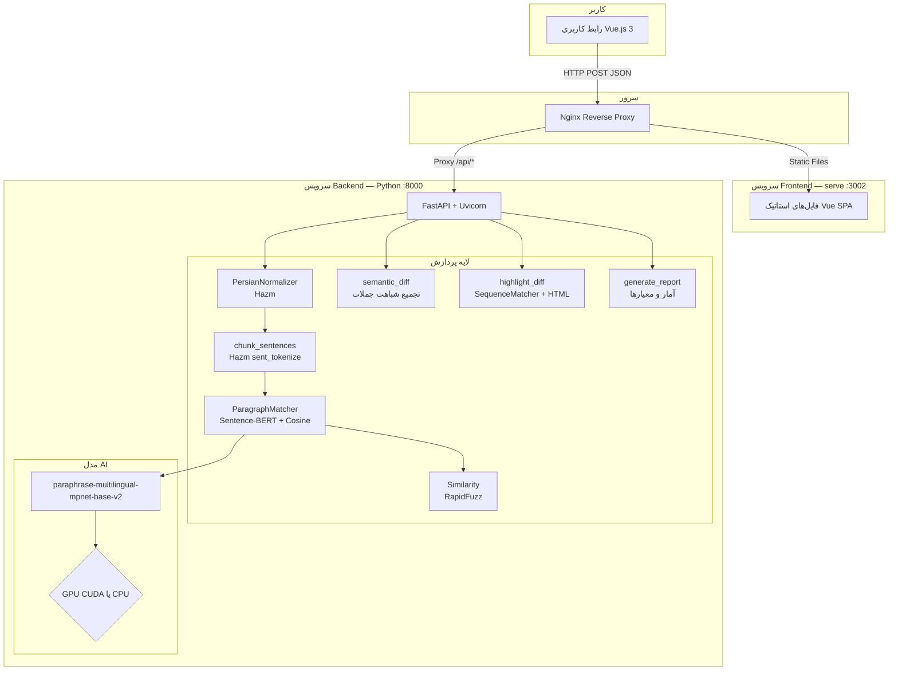
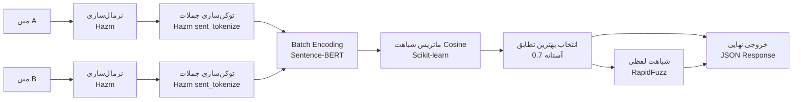
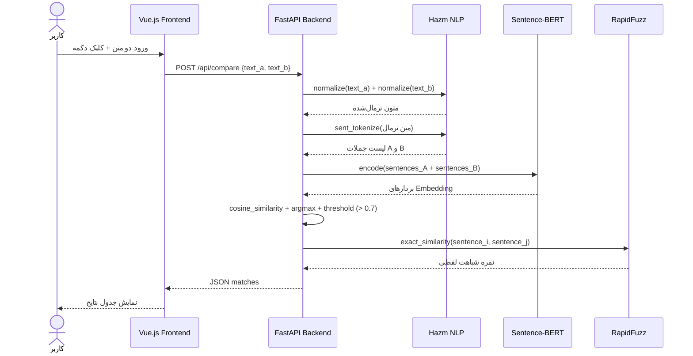

<div dir="rtl">

# 🦇 Batman — سامانه تشخیص شباهت نصوص

> بستری هوشمند برای تحلیل معنایی، تشخیص تشابه و کشف سرقت ادبی در متون فارسی

<div align="center">


</div>

---

## 📑 فهرست مطالب

- [معرفی پروژه](#-معرفی-پروژه)
- [فناوری‌های استفاده‌شده](#-فناوری‌های-استفاده‌شده)
- [معماری سیستم](#-معماری-سیستم)
- [قابلیت‌های سامانه](#-قابلیت‌های-سامانه)
- [الگوریتم‌ها و روند پردازش](#-الگوریتم‌ها-و-روند-پردازش)
- [ساختار پوشه‌ها و فایل‌ها](#-ساختار-پوشه‌ها-و-فایل‌ها)
- [نحوه نصب و راه‌اندازی](#-نحوه-نصب-و-راه‌اندازی)
- [تنظیمات مورد نیاز](#-تنظیمات-مورد-نیاز)
- [راهنمای اجرا](#-راهنمای-اجرا)
- [مستندات API](#-مستندات-api)
- [نمونه ورودی و خروجی](#-نمونه-ورودی-و-خروجی)
- [محدودیت‌های فعلی](#-محدودیت‌های-فعلی)
- [پیشنهادهای توسعه آینده](#-پیشنهادهای-توسعه-آینده)
- [جمع‌بندی](#-جمع‌بندی)

---

## 🎯 معرفی پروژه

### هدف پروژه

**Batman** یک سامانه دانشگاهی در حوزه پردازش زبان طبیعی (NLP) است که با هدف **تشخیص شباهت معنایی و کلمه‌به‌کلمه میان دو متن فارسی** طراحی و پیاده‌سازی شده است. این سامانه قادر است دو متن ورودی را در سطح جمله تحلیل کرده، میزان تشابه معنایی و ظاهری آن‌ها را محاسبه نماید و گزارشی جامع از احتمال سرقت ادبی ارائه دهد.

### بیان مسئله

با گسترش تولید محتوای دیجیتال، اطمینان از **اصالت متون** به یک چالش جدی تبدیل شده است. روش‌های سنتی تشخیص تشابه، صرفاً بر اساس تطابق رشته‌ای (string matching) عمل می‌کنند و از درک معنای جملات عاجزند. به همین دلیل، متونی که با بازنویسی، ترادف‌گذاری یا تغییر ساختار نگارشی تهیه می‌شوند، از چشم این سیستم‌ها پنهان می‌مانند.

این پروژه با بهره‌گیری از مدل‌های **یادگیری عمیق چندزبانه** و تکنیک‌های پیشرفته NLP، این خلأ را پر کرده و قادر است تشابه معنایی را فراتر از تطابق لغوی شناسایی کند.

### اهمیت موضوع

- **محیط‌های دانشگاهی:** تشخیص سرقت ادبی در پایان‌نامه‌ها، مقالات و گزارش‌های علمی
- **ناشران و رسانه‌ها:** بررسی اصالت محتوای منتشرشده
- **سیستم‌های قضایی و حقوقی:** مقایسه اسناد و قراردادها
- **پلتفرم‌های آموزشی:** ارزیابی اصالت تکالیف دانشجویان

### کاربردهای سامانه

| کاربرد               | توضیح                                        |
| -------------------- | -------------------------------------------- |
| **تشخیص سرقت ادبی**  | شناسایی محتوای کپی‌شده یا بازنویسی‌شده       |
| **مقایسه نسخ اسناد** | یافتن تفاوت‌های معنایی بین دو نسخه از یک سند |
| **تحلیل محتوا**      | ارزیابی میزان همپوشانی موضوعی دو متن         |
| **بررسی ترجمه**      | مقایسه متن اصلی با ترجمه در سطح معنایی       |

---

## 🛠 فناوری‌های استفاده‌شده

### ۱. Python 3.13

**کاربرد:** زبان اصلی پیاده‌سازی Backend  
**دلیل انتخاب:** اکوسیستم غنی کتابخانه‌های NLP و یادگیری ماشین، سادگی کد، و پشتیبانی گسترده از ابزارهای هوش مصنوعی  
**تعامل:** تمام ماژول‌های پردازشی، مدل‌های یادگیری ماشین و سرویس API در Python پیاده‌سازی شده‌اند

### ۲. FastAPI

**کاربرد:** فریم‌ورک ساخت RESTful API در سمت Backend  
**دلیل انتخاب:** عملکرد بالا (مبتنی بر ASGI)، تولید خودکار مستندات Swagger، اعتبارسنجی داده با Pydantic، و پشتیبانی native از async  
**تعامل:** سه endpoint اصلی (`/api/compare`، `/api/report`، `/api/diff-highlight`) به‌همراه `/api/health` را در معرض دسترسی Frontend قرار می‌دهد. مسیرهای قدیمی بدون پیشوند (`/compare` و ...) برای سازگاری همچنان کار می‌کنند ولی در مستندات Swagger نمایش داده نمی‌شوند

### ۳. Sentence-Transformers — paraphrase-multilingual-mpnet-base-v2

**کاربرد:** تبدیل جملات به بردارهای عددی (Sentence Embedding) برای محاسبه شباهت معنایی  
**دلیل انتخاب:** این مدل به‌صورت چندزبانه آموزش دیده و از زبان فارسی پشتیبانی می‌کند. معماری `mpnet-base` دقت بالایی در تشخیص معنای جملات دارد  
**تعامل:** جملات هر دو متن در یک فراخوانی batch به این مدل داده می‌شوند و بردارهای حاصل برای محاسبه ماتریس شباهت cosine استفاده می‌گردند. در هر درخواست، embedding ها فقط یک‌بار محاسبه و بین همه تحلیل‌ها به اشتراک گذاشته می‌شوند

### ۴. Hazm

**کاربرد:** پردازش زبان طبیعی اختصاصی زبان فارسی (نرمال‌سازی و توکن‌سازی)  
**دلیل انتخاب:** تنها کتابخانه بومی و بالغ برای NLP فارسی با پشتیبانی از نیم‌فاصله، ویرایش اعداد و نرمال‌سازی حروف  
**تعامل:** پیش از هرگونه پردازش، متن ورودی از طریق `PersianNormalizer` نرمال و سپس توسط `sent_tokenize` به جملات مجزا تقسیم می‌شود

### ۵. PyTorch

**کاربرد:** موتور محاسباتی زیرین برای اجرای مدل‌های یادگیری عمیق  
**دلیل انتخاب:** کتابخانه استاندارد برای اجرای مدل‌های Hugging Face و Sentence-Transformers  
**تعامل:** در صورت وجود GPU، سامانه به‌صورت خودکار از CUDA استفاده می‌کند؛ در غیر این صورت روی CPU اجرا می‌شود

### ۶. Scikit-learn

**کاربرد:** محاسبه ماتریس شباهت Cosine بین embedding های جملات  
**دلیل انتخاب:** پیاده‌سازی بهینه و بردارسازی‌شده `cosine_similarity` برای عملیات ماتریسی  
**تعامل:** در `matcher.py` برای محاسبه سریع ماتریس شباهت بین تمامی جفت جملات به کار می‌رود

### ۷. RapidFuzz

**کاربرد:** محاسبه شباهت لفظی (کلمه‌به‌کلمه) با مقایسه‌ی تقریبی کلمات  
**دلیل انتخاب:** پیاده‌سازی بسیار سریع‌تر از `difflib` با الگوریتم Levenshtein بهینه‌شده  
**تعامل:** در `similarity.py` برای محاسبه شباهت هر جفت کلمه (`process.cdist`) و سپس `exact_similarity` جفت جملات تطبیق‌یافته استفاده می‌شود

### ۸. difflib — کتابخانه استاندارد Python

**کاربرد:** تشخیص تفاوت‌های ظاهری در سطح کلمه بین دو متن با `SequenceMatcher`  
**دلیل انتخاب:** موجود در کتابخانه استاندارد Python بدون نیاز به وابستگی خارجی؛ مناسب برای تولید diff کلمه‌به‌کلمه  
**تعامل:** در `highlight.py` برای تولید HTML annotated diff با برچسب‌گذاری مناطق تغییر، حذف و اضافه استفاده می‌شود

### ۹. Vue.js 3 — Composition API

**کاربرد:** فریم‌ورک ساخت رابط کاربری تعاملی (SPA)  
**دلیل انتخاب:** معماری Composition API انعطاف‌پذیری بیشتری در مدیریت state دارد؛ چرخه توسعه سریع با Vite  
**تعامل:** از طریق Axios با Backend ارتباط برقرار می‌کند و خروجی HTML دریافتی از `/api/diff-highlight` را رندر می‌کند (تمام متن کاربر در Backend با `html.escape` امن‌سازی می‌شود)

### ۱۰. Vite

**کاربرد:** ابزار Build و Dev Server برای Frontend  
**دلیل انتخاب:** سرعت بسیار بالا در hot-reload، پشتیبانی native از Vue 3  
**تعامل:** در محیط توسعه، درخواست‌های API را به‌صورت Proxy به Backend ارسال می‌کند

### ۱۱. TailwindCSS

**کاربرد:** فریم‌ورک CSS برای طراحی رابط کاربری  
**دلیل انتخاب:** رویکرد utility-first برای طراحی سریع و سازگار  
**تعامل:** در کنار CSS سفارشی تعریف‌شده در `main.css` برای استایل‌دهی کامپوننت‌ها به کار می‌رود

### ۱۲. Axios

**کاربرد:** کلاینت HTTP در Frontend برای ارتباط با Backend API  
**دلیل انتخاب:** API ساده و promise-based، پشتیبانی خودکار از JSON، مدیریت ساده خطاها  
**تعامل:** در `api/index.js` سه تابع مجزا برای هر endpoint تعریف شده‌اند

### ۱۳. Nginx (روی سرور)

**کاربرد:** Reverse Proxy در محیط Production (خارج از Docker Compose)  
**دلیل انتخاب:** کارایی بالا و مدیریت دامنه/SSL در یک نقطه  
**تعامل:** درخواست‌های `/api/*` را به Backend (پورت `8000`) و سایر مسیرها را به کانتینر Frontend (پورت `3002`، سرویس‌دهی فایل‌های استاتیک با `serve` و SPA fallback) ارسال می‌کند — نمونه تنظیمات در بخش «استقرار پشت Nginx سرور»

### ۱۴. Docker و Docker Compose

**کاربرد:** کانتینرسازی و استقرار یکپارچه سامانه  
**دلیل انتخاب:** استقرار قابل تکرار و مستقل از محیط اجرا  
**تعامل:** دو سرویس `backend` و `frontend` با شبکه داخلی Docker به هم متصل هستند

---

## 🏗 معماری سیستم

### نمودار معماری کلی



### نمودار جریان داده



### نمودار تعامل اجزا



---

## ✨ قابلیت‌های سامانه

### ۱. مقایسه جملات (Compare)

- تقسیم خودکار متون به جملات با استفاده از توکن‌ساز فارسی Hazm
- محاسبه شباهت **معنایی** برای هر جمله از متن اول با تمام جملات متن دوم
- انتخاب نزدیک‌ترین جمله معنایی و ارائه نمره شباهت
- محاسبه همزمان شباهت **لفظی** (کلمه‌به‌کلمه؛ مستقل از فاصله، نیم‌فاصله و علائم نگارشی)
- نمایش جدولی نتایج با رنگ‌بندی سه‌سطحی (بالا ≥۹۰٪، متوسط ≥۷۰٪، پایین)

### ۲. گزارش سرقت ادبی (Report)

- محاسبه **پوشش** (Coverage) هر متن: چه درصدی از جملات در متن دیگر معادل دارند
- محاسبه **میانگین شباهت معنایی** و **میانگین شباهت لفظی** کل جملات تطبیق‌یافته
- ارائه **حکم نهایی** در سه سطح: احتمال بالای سرقت ادبی / شباهت متوسط / بدون شباهت قابل‌توجه

### ۳. تفاوت و هایلایت (Diff Highlight)

- محاسبه شباهت معنایی کلی دو متن (بر اساس تمام جملات؛ بدون محدودیت طول ورودی مدل)
- شناسایی جملاتی که **معادل معنایی** در متن دیگر ندارند (فقط در متن اول / فقط در متن دوم) — جملات بازنویسی‌شده تفاوت محسوب نمی‌شوند
- تولید diff در سطح کلمه با رنگ‌گذاری HTML
- شناسایی هوشمند متون **کاملاً متفاوت** با دو gate معنایی و هم‌پوشانی کلمات

---

## 🔬 الگوریتم‌ها و روند پردازش

### مرحله ۱: پیش‌پردازش و نرمال‌سازی متن

کلاس `PersianNormalizer` در `normalizer.py` از `HazmNormalizer` استفاده می‌کند:

- یکسان‌سازی کدگذاری حروف عربی و فارسی (مانند «ي» و «ی»، «ك» و «ک»)
- اصلاح فاصله‌گذاری و نیم‌فاصله‌ها
- نرمال‌سازی اعداد و نشانه‌گذاری

### مرحله ۲: توکن‌سازی جملات

تابع `chunk_sentences` در `chunker.py` از `sent_tokenize` کتابخانه Hazm استفاده می‌کند که برای ساختار دستوری زبان فارسی بهینه شده است. خروجی این مرحله لیستی از جملات پالایش‌شده است؛ قطعه‌هایی که هیچ حرف یا عددی ندارند (مثلاً `...` یا `!!!`) حذف می‌شوند تا تطابق‌های بی‌معنا ایجاد نکنند. اگر پس از این مرحله یکی از متن‌ها هیچ جمله‌ای نداشته باشد، API خطای `400` برمی‌گرداند.

> نکته: Hazm حروف کشیده (تکرار سه‌باره یا بیشتر) را کوتاه می‌کند و تک‌خط‌شکنی را مرز جمله نمی‌داند؛ پاراگراف‌ها (دو خط‌شکنی) جملات جدا محسوب می‌شوند.

### مرحله ۳: تبدیل به بردار (Sentence Embedding)

`ParagraphMatcher` هر دو لیست جملات را با یک فراخوانی batch به مدل Sentence-BERT ارسال می‌کند. مدل `paraphrase-multilingual-mpnet-base-v2` یک بردار ۷۶۸ بعدی برای هر جمله تولید می‌کند که معنای کامل آن را کدگذاری می‌کند. تعداد فراخوانی‌های همزمان مدل با `MAX_CONCURRENT_INFERENCE` محدود می‌شود تا درخواست‌های سنگین همزمان CPU و RAM را اشباع نکنند.

### مرحله ۴: محاسبه ماتریس شباهت

```
sim_matrix[i][j] = cosine_similarity(emb_a[i], emb_b[j])
```

برای هر جمله از متن A، نزدیک‌ترین جمله از متن B (بالاترین cosine) انتخاب می‌شود. این دو جمله **تطابق** دارند اگر:

- شباهت معنایی از **آستانه ۰٫۷** بیشتر باشد، **یا**
- شباهت لفظی دست‌کم **۰٫۸** باشد (کپی تقریباً کلمه‌به‌کلمه، حتی اگر یک کلمه معنا را برعکس کرده باشد؛ مثل «افزایش یافت» ← «کاهش یافت»).

آستانه‌ها روی جفت‌جمله‌های فارسی با همین مدل کالیبره شده‌اند:

| نوع جفت جمله                                              | شباهت معنایی |
| --------------------------------------------------------- | ------------ |
| بازنویسی، مترادف، ترجمه، کپی بخشی از جمله، تغییر عدد      | ۰٫۷۵ تا ۰٫۹۹ |
| فقط هم‌موضوع (مثلاً «دانشجویان درس می‌خوانند» / «استادان تدریس می‌کنند») | ۰٫۲۶ تا ۰٫۵۹ |
| بی‌ربط                                                    | ۰٫۱- تا ۰٫۱  |

همین قاعده در هر سه بخش (مقایسه، گزارش و «فقط در متن ...») به کار می‌رود تا نتایج هیچ‌وقت با هم تناقض نداشته باشند.

**شباهت معنایی کلی دو متن** (در `semantic.py`) از همین ماتریس محاسبه می‌شود:

```
semantic_similarity = ½ · ( mean_i max(0, max_j S[i][j])  +  mean_j max(0, max_i S[i][j]) )
```

یعنی برای هر جمله، شباهت نزدیک‌ترین جمله متن دیگر گرفته شده (شباهت منفی صفر حساب می‌شود) و میانگین دو جهت محاسبه می‌شود. برای دو متن تک‌جمله‌ای، این مقدار همان cosine معمولی است. دلیل این روش: مدل ورودی را در **۱۲۸ توکن** قطع می‌کند؛ اگر کل متن یک‌جا embed شود، دو متن طولانی با مقدمه یکسان و ادامه کاملاً متفاوت شباهت ۱٫۰ می‌گیرند.

جمله‌ای «فقط در متن اول» است که طبق قاعده‌ی بالا در متن دوم تطابقی نداشته باشد.

### مرحله ۵: شباهت لفظی (کلمه‌به‌کلمه)

کلاس `Similarity` در `similarity.py` شباهت لفظی را **در سطح کلمه** محاسبه می‌کند (فیلد `exact_similarity` در API):

۱. **پاک‌سازی:** علائم نگارشی، نمادها، نیم‌فاصله، فاصله‌های اضافه، اعراب (ـَ ـِ ـُ ...)، کشیده (ـ) و تفاوت «ي/ی» و «ك/ک» نادیده گرفته می‌شوند. نیم‌فاصله مانند فاصله جداکننده‌ی کلمه است، پس «هوش‌مصنوعی» و «هوش مصنوعی» یکسان‌اند.
۲. **تطبیق کلمات:** دو کلمه وقتی یکسان حساب می‌شوند که شباهت حرفی‌شان دست‌کم ۰٫۸ باشد؛ به این ترتیب «کتاب» و «کتابها» امتیاز جزئی می‌گیرند ولی کلمات بی‌ربط امتیازی ندارند.
۳. **امتیاز:** طولانی‌ترین زیردنباله‌ی مشترک کلمات (با حفظ ترتیب) محاسبه و به‌صورت `2 × LCS / (len(a) + len(b))` بیان می‌شود.

چرا مقایسه‌ی حرف‌به‌حرف کنار گذاشته شد؟ در آن روش فاصله‌ها و حروف پرتکرار فارسی (ا، ی، ن، ر) همیشه هم‌خوانی دارند؛ دو جمله‌ی کاملاً بی‌ربط حدود ۴۰٪ شباهت می‌گرفتند و تفاوت فاصله یا نیم‌فاصله نمره‌ی جمله‌های یکسان را کم می‌کرد. اکنون جمله‌های بی‌ربط ۰٪ و جمله‌هایی که فقط در قالب‌بندی تفاوت دارند ۱۰۰٪ می‌گیرند.

| نمونه                                   | شباهت لفظی |
| --------------------------------------- | ---------- |
| یکسان / تفاوت فقط در فاصله و علائم      | ۱۰۰٪       |
| یک کلمه تغییرکرده در جمله‌ی ۹ کلمه‌ای   | ۸۹٪        |
| بازنویسی با کلمات متفاوت                | ۲۲ تا ۴۳٪  |
| بی‌ربط                                  | ۰٪         |

### مرحله ۶: تولید Diff هوشمند

ماژول `highlight.py` دو gate کنترل کیفیت دارد:

| Gate              | آستانه | توضیح                                           |
| ----------------- | ------ | ----------------------------------------------- |
| Gate 1: معنایی    | `0.10` | زیر این مقدار متن‌ها کاملاً متفاوت تلقی می‌شوند |
| Gate 2: هم‌پوشانی | `0.10` | نسبت SequenceMatcher روی کلمات بررسی می‌شود     |

در صورت عبور از هر دو gate، تفاوت‌های کلمه‌به‌کلمه با `SequenceMatcher.get_opcodes()` روی **کلمات** (بدون فاصله‌ها؛ با همان پاک‌سازی مرحله ۵، پس «است.» و «است» تغییر محسوب نمی‌شوند) محاسبه و با برچسب‌های HTML رنگ‌بندی می‌شوند (جایگزین‌شده با شماره‌گذاری ① ② ③ ...). به این ترتیب یک عبارت چندکلمه‌ای تغییریافته یک شماره می‌گیرد، نه یک شماره برای هر کلمه. هر دو آستانه از طریق متغیرهای محیطی قابل تنظیم‌اند.

### مرحله ۷: تولید گزارش آماری

تابع `generate_report` در `report.py` معیارهای زیر را محاسبه می‌کند:

| معیار                     | فرمول                                     |
| ------------------------- | ----------------------------------------- |
| `coverage_a`              | تعداد جملات تطبیق‌یافته از A ÷ کل جملات A |
| `coverage_b`              | تعداد جملات B که معادلی (cosine > آستانه) در A دارند ÷ کل جملات B |
| `avg_semantic_similarity` | میانگین نمرات cosine کلیه تطابق‌ها        |
| `avg_exact_similarity`    | میانگین شباهت لفظی کلیه تطابق‌ها          |

---

## 📁 ساختار پوشه‌ها و فایل‌ها

```
Batman/
├── app.py                   # نقطه ورود FastAPI — endpoint ها، اعتبارسنجی، CORS، بارگذاری مدل
├── config.py                # تنظیمات قابل تغییر با متغیرهای محیطی
├── normalizer.py            # کلاس PersianNormalizer — نرمال‌سازی متن فارسی
├── chunker.py               # تابع chunk_sentences — توکن‌سازی جملات
├── matcher.py               # کلاس ParagraphMatcher — تطابق با Sentence-BERT
├── similarity.py            # کلاس Similarity — شباهت لفظی در سطح کلمه
├── semantic.py              # شباهت معنایی کلی و تفاوت معنایی جملات
├── highlight.py             # تابع highlight_diff — diff HTML کلمه‌به‌کلمه
├── report.py                # تابع generate_report — گزارش آماری
├── requirements.txt         # وابستگی‌های Python
├── requirements-dev.txt     # وابستگی‌های تست و lint (pytest، ruff)
├── pytest.ini / ruff.toml   # تنظیمات تست و lint
├── tests/                   # تست‌های Backend (pytest)
├── Dockerfile               # Docker image برای Backend (مدل در زمان build دانلود می‌شود)
├── docker-compose.yml       # اجرای همزمان Frontend و Backend
├── .env.example             # نمونه متغیرهای محیطی (proxy، محدودیت‌ها، CORS)
└── vue-frontend/
    ├── index.html
    ├── vite.config.js       # تنظیمات Vite + Proxy توسعه
    ├── package.json         # وابستگی‌های Node.js
    ├── tailwind.config.js
    ├── Dockerfile           # Multi-stage build (Node → serve، بدون دسترسی root)
    ├── tests/               # تست‌های Frontend (Vitest + Vue Test Utils)
    └── src/
        ├── App.vue          # کامپوننت ریشه — مسیریابی tab ها
        ├── main.js
        ├── config.js        # حداکثر طول متن و timeout درخواست
        ├── utils/
        │   └── format.js    # قالب‌بندی درصدها (محدود به ۰ تا ۱۰۰)
        ├── api/
        │   └── index.js     # لایه API — توابع Axios و پیام‌های خطای فارسی
        ├── composables/
        │   └── useTextSubmit.js    # Composable مشترک state و fetch
        ├── components/
        │   ├── CompareView.vue     # نمای مقایسه جملات
        │   ├── ReportView.vue      # نمای گزارش سرقت ادبی
        │   ├── DiffView.vue        # نمای diff و هایلایت
        │   └── TextInputsGrid.vue  # کامپوننت ورودی متن
        └── assets/
            ├── main.css
            └── fonts/
                └── Vazirmatn-Regular.woff2
```

---

## ⚙️ نحوه نصب و راه‌اندازی

### پیش‌نیازها

| ابزار          | نسخه مورد نیاز                 |
| -------------- | ------------------------------ |
| Python         | >= 3.11 (تست‌شده با 3.13)       |
| Node.js        | >= 20.19 یا >= 22.12           |
| Docker         | Latest                         |
| Docker Compose | >= 2.0                         |

---

### روش ۱: اجرا با Docker (توصیه‌شده)

این روش ساده‌ترین و مطمئن‌ترین راه اجرای سامانه است:

```bash
git clone <repository-url>
cd Batman
cp .env.example .env        # اختیاری: proxy، محدودیت طول متن، CORS
docker compose up --build
```

پس از اجرا:

- **رابط کاربری:** از طریق Nginx سرور (پایین را ببینید) — کانتینر Frontend روی پورت `3002` است
- **مستندات API:** `http://localhost:8000/docs` (فقط از همین سیستم؛ پورت 8000 روی `127.0.0.1` منتشر می‌شود)

مدل (~۱.۱ گیگابایت) **هنگام build** در ایمیج Backend قرار می‌گیرد؛ بنابراین کانتینر در زمان اجرا به اینترنت نیاز ندارد. اگر برای دسترسی به اینترنت هنگام build به proxy نیاز دارید، `HTTP_PROXY` و `HTTPS_PROXY` را در `.env` تنظیم کنید (این مقادیر در ایمیج ذخیره نمی‌شوند).

#### خطای DNS یا proxy هنگام build (`Temporary failure in name resolution`)

کانتینر build به‌طور پیش‌فرض از DNS خود Docker استفاده می‌کند (مقدار `dns` در `/etc/docker/daemon.json`، یا `8.8.8.8` اگر DNS سرور `127.0.0.53` باشد) و به `127.0.0.1` سرور هم دسترسی ندارد. اگر روی سرور خطای `Failed to resolve 'files.pythonhosted.org'` می‌بینید، یا proxy شما روی `127.0.0.1` است، یکی از این دو راه را انتخاب کنید:

**راه ۱ — اصلاح دائمی DNS داکر (توصیه‌شده):** DNS سروری را که روی خود سرور درست کار می‌کند پیدا کنید:

```bash
resolvectl status | grep "DNS Servers"      # یا: cat /etc/resolv.conf
getent hosts files.pythonhosted.org          # روی سرور باید IP برگرداند
docker run --rm python:3.13-slim getent hosts files.pythonhosted.org   # داخل داکر
```

همان IPها را در `/etc/docker/daemon.json` بگذارید (مثلاً `{"dns": ["<DNS-1>", "<DNS-2>"]}`)، سپس `sudo systemctl restart docker` و `docker compose up -d --build`.

**راه ۲ — build با شبکه‌ی سرور (مثل قبل):** نسخه‌های جدید Compose برای build از bake استفاده می‌کنند و `network: host` را بدون اجازه‌ی صریح نمی‌پذیرند (خطای `additional privileges requested: pass "--allow=network.host"`)، و `docker compose build` هم گزینه‌ی `--allow` ندارد. به‌جای آن مستقیماً از `buildx bake` استفاده کنید:

```bash
cat > docker-compose.override.yml <<'EOF'
services:
  backend:
    build:
      network: host
EOF
docker buildx bake --allow=network.host --load -f docker-compose.yml -f docker-compose.override.yml
docker compose up -d --no-build
```

`docker-compose.override.yml` در `.gitignore` است و فقط روی همان سرور می‌ماند. پس از ساختن آن، برای build همیشه از دستور `buildx bake` بالا استفاده کنید، چون `docker compose up --build` این فایل را می‌خواند و دوباره به همان خطای دسترسی می‌خورد. روی سرورهایی که DNS داکرشان درست کار می‌کند به هیچ‌کدام از این‌ها نیازی نیست.

برای اجرا در پس‌زمینه:

```bash
docker compose up --build -d
```

برای توقف:

```bash
docker compose down
```

### اجرای محلی با Docker (بدون Nginx)

کانتینر Frontend درخواست‌های `/api` را به Backend نمی‌فرستد. برای استفاده محلی بدون reverse proxy، در `.env` مقدار زیر را قرار دهید تا مرورگر مستقیماً Backend را صدا بزند، سپس `docker compose up -d --build` را اجرا کرده و `http://localhost:3002` را باز کنید:

```env
API_BASE_URL=http://localhost:8000
```

روی سرور (پشت Nginx) این مقدار را **خالی** بگذارید. اگر `/api` به Backend متصل نباشد، رابط کاربری به‌جای نتیجه‌ی خالی، خطای «پاسخ نامعتبر از سرور» نشان می‌دهد.

### استقرار پشت Nginx سرور

کانتینر Frontend فقط فایل‌های استاتیک را با `serve` روی پورت `3002` ارائه می‌دهد و خودش درخواستی را به Backend نمی‌فرستد. رابط کاربری API را از همان origin و با مسیر `/api/*` صدا می‌زند، بنابراین Nginx سرور باید `/api/` را به Backend و بقیه مسیرها را به Frontend بفرستد. نمونه:

```nginx
server {
    listen 80;
    server_name example.com;

    # دو متن ۵۰ هزار کاراکتری به‌راحتی در ۱ مگابایت جا می‌شوند
    client_max_body_size 1m;

    location /api/ {
        proxy_pass         http://127.0.0.1:8000;
        proxy_set_header   Host $host;
        proxy_set_header   X-Real-IP $remote_addr;
        proxy_set_header   X-Forwarded-For $proxy_add_x_forwarded_for;
        proxy_set_header   X-Forwarded-Proto $scheme;
        # متن‌های طولانی روی CPU ممکن است چند ثانیه تا چند ده ثانیه طول بکشند
        proxy_read_timeout 300s;
    }

    location / {
        proxy_pass       http://127.0.0.1:3002;
        proxy_set_header Host $host;
    }
}
```

پورت `8000` فقط روی `127.0.0.1` منتشر می‌شود؛ این برای Nginx نصب‌شده روی خود سرور کافی است. اگر Nginx در کانتینر یا روی سیستم دیگری اجرا می‌شود، بخش `ports` سرویس `backend` در `docker-compose.yml` را متناسب تغییر دهید.

---

### روش ۲: اجرا محلی بدون Docker

#### Backend

```bash
python -m venv .venv
.venv\Scripts\activate      # Windows
source .venv/bin/activate   # Linux/Mac

pip install -r requirements.txt
uvicorn app:app --host 127.0.0.1 --port 8000 --reload
```

در اولین اجرا مدل از Hugging Face Hub دانلود و در cache محلی ذخیره می‌شود.

#### Frontend

```bash
cd vue-frontend
npm install          # یا: pnpm install
npm run dev
```

سرور توسعه Vite درخواست‌های `/api/*` را به `http://127.0.0.1:8000` می‌فرستد (قابل تغییر با متغیر `API_PROXY_TARGET`).

پس از اجرا:

- **رابط کاربری:** `http://localhost:3002`
- **مستندات API:** `http://localhost:8000/docs`

---

### اجرای تست‌ها

```bash
# Backend (pytest) — تست‌های مدل واقعی فقط وقتی مدل در cache محلی باشد اجرا می‌شوند
pip install -r requirements-dev.txt
python -m pytest              # همه تست‌ها
python -m pytest -m "not model"   # فقط تست‌های سریع (با مدل جعلی)
python -m ruff check .        # lint

# Frontend (Vitest + Vue Test Utils)
cd vue-frontend
npm test
npm run build
```

---

## 🔧 تنظیمات مورد نیاز

### تنظیمات Backend (متغیرهای محیطی)

همه مقادیر اختیاری‌اند؛ مقدار نامعتبر هنگام راه‌اندازی با پیام خطای واضح متوقف می‌شود.

| متغیر                         | مقدار پیش‌فرض                           | توضیح                                                     |
| ----------------------------- | --------------------------------------- | --------------------------------------------------------- |
| `MODEL_NAME`                  | `paraphrase-multilingual-mpnet-base-v2` | نام مدل Sentence-BERT (در Docker یک build arg است)        |
| `DEVICE`                      | خودکار (`cuda` / `cpu`)                 | انتخاب خودکار بر اساس موجودیت GPU                         |
| `SIMILARITY_THRESHOLD`        | `0.7`                                   | حداقل نمره cosine برای تطابق (و برای «فقط در متن ...»)    |
| `LEXICAL_MATCH_THRESHOLD`     | `0.8`                                   | حداقل شباهت لفظی که به‌تنهایی تطابق حساب می‌شود (کپی تقریباً کلمه‌به‌کلمه) |
| `DIFF_SEMANTIC_THRESHOLD`     | `0.10`                                  | آستانه معنایی برای فعال‌سازی diff                         |
| `DIFF_TEXT_OVERLAP_THRESHOLD` | `0.10`                                  | آستانه هم‌پوشانی کلمات                                    |
| `MAX_TEXT_LENGTH`             | `50000`                                 | حداکثر تعداد کاراکتر هر متن (بیشتر ← خطای `413`)          |
| `MAX_CONCURRENT_INFERENCE`    | `2`                                     | حداکثر اجرای همزمان مدل                                   |
| `CORS_ORIGINS`                | `http://localhost:3002,http://127.0.0.1:3002` | originهای مجاز (جداشده با کاما)                    |

در Docker Compose، `MAX_TEXT_LENGTH` هم به Backend و هم (به‌صورت `VITE_MAX_TEXT_LENGTH`) به build رابط کاربری داده می‌شود تا شمارنده و اعتبارسنجی سمت کاربر با Backend یکسان بماند. Backend بدنه‌های بزرگ‌تر از حد مجاز را با خطای `413` رد می‌کند؛ اگر `MAX_TEXT_LENGTH` را بیش از حدود ۸۰ هزار افزایش دادید، `client_max_body_size` در Nginx سرور را هم بزرگ‌تر کنید.

### CORS

رابط کاربری از طریق proxy (Vite در توسعه، Nginx سرور در Production) و با همان origin به API دسترسی دارد، بنابراین CORS برای آن لازم نیست. `CORS_ORIGINS` فقط برای کلاینت‌هایی است که مستقیماً از مرورگر و از origin دیگری API را صدا می‌زنند.

### دانلود مدل

در Docker، مدل `paraphrase-multilingual-mpnet-base-v2` هنگام build از Hugging Face Hub دانلود و در ایمیج ذخیره می‌شود و کانتینر در حالت آفلاین (`HF_HUB_OFFLINE=1`) اجرا می‌شود. در اجرای محلی، مدل در اولین اجرا دانلود می‌شود (حدود ۱.۱ گیگابایت).

---

## 🚀 راهنمای اجرا

### بخش «مقایسه جملات»

۱. متن اول را در فیلد «متن اول» وارد کنید  
۲. متن دوم را در فیلد «متن دوم» وارد کنید  
۳. دکمه «شروع مقایسه» را فشار دهید  
۴. جدول نتایج نشان می‌دهد کدام جمله از متن اول با کدام جمله از متن دوم تطابق دارد، به همراه نمره شباهت معنایی و دقیق

### بخش «گزارش سرقت ادبی»

۱. دو متن را وارد کنید  
۲. دکمه «دریافت گزارش» را فشار دهید  
۳. آمارهای تفصیلی شامل درصد پوشش هر متن و میانگین شباهت‌ها نمایش داده می‌شود  
۴. حکم نهایی (احتمال بالا/متوسط/پایین سرقت ادبی) ارائه می‌گردد

### بخش «تفاوت و هایلایت»

۱. دو متن را وارد کنید  
۲. دکمه «نمایش تفاوت» را فشار دهید  
۳. کلمات مشابه، جایگزین‌شده، حذف‌شده و اضافه‌شده با رنگ‌های مختلف مشخص می‌شوند

---

## 📡 مستندات API

همه endpointها زیر پیشوند `/api` هستند و بدنه یکسان `{"text_a": "...", "text_b": "..."}` می‌گیرند. مسیرهای قدیمی بدون پیشوند (`/compare`، `/report`، `/diff-highlight`) برای سازگاری همچنان پاسخ می‌دهند. مستندات تعاملی کامل در `/docs` در دسترس است.

**خطاها** (بدنه: `{"detail": "..."}`):

| کد    | علت                                                                       |
| ----- | ------------------------------------------------------------------------- |
| `400` | یکی از متن‌ها خالی است، یا پس از نرمال‌سازی هیچ جمله‌ی معناداری ندارد     |
| `413` | طول یکی از متن‌ها از `MAX_TEXT_LENGTH` بیشتر است یا بدنه درخواست بیش از حد بزرگ است |
| `422` | ساختار JSON نامعتبر است (مثلاً فیلد ناموجود یا نوع غیر رشته‌ای)           |

### GET /api/health

بررسی سلامت سرویس (پس از بارگذاری مدل): `{"status": "ok"}`

### POST /api/compare

**توضیح:** مقایسه جمله‌به‌جمله دو متن و یافتن بهترین تطابق معنایی

**درخواست:**

```json
{
  "text_a": "متن اول در اینجا قرار می‌گیرد.",
  "text_b": "متن دوم در اینجا قرار می‌گیرد."
}
```

**پاسخ:**

```json
{
  "matches": [
    {
      "a_index": 0,
      "b_index": 0,
      "similarity": 0.9231,
      "exact_similarity": 0.875,
      "text_a": "جمله از متن اول",
      "text_b": "جمله از متن دوم"
    }
  ]
}
```

---

### POST /api/report

**توضیح:** تولید گزارش آماری تشخیص سرقت ادبی

**پاسخ:**

```json
{
  "report": {
    "matched_count": 5,
    "coverage_a": 0.714,
    "coverage_b": 0.625,
    "avg_semantic_similarity": 0.823,
    "avg_exact_similarity": 0.541
  },
  "matches": []
}
```

---

### POST /api/diff-highlight

**توضیح:** تحلیل تفاوت معنایی و تولید HTML هایلایت‌شده

**پاسخ:**

```json
{
  "semantic_diff": {
    "semantic_similarity": 0.7841,
    "only_in_a": ["جمله فقط در متن A"],
    "only_in_b": ["جمله فقط در متن B"]
  },
  "highlight": {
    "a_html": "<span class=\"diff-equal\">متن مشابه</span>",
    "b_html": "<span class=\"diff-equal\">متن مشابه</span>",
    "completely_different": false
  }
}
```

---

## 📊 نمونه ورودی و خروجی

### نمونه: شباهت بالا (سرقت ادبی احتمالی)

**متن اول:**

> هوش مصنوعی به ماشین‌ها این توانایی را می‌دهد که از تجربه یاد بگیرند و وظایف انسانی را انجام دهند.

**متن دوم:**

> هوش مصنوعی قابلیت یادگیری از تجربه را به سیستم‌های کامپیوتری می‌دهد تا بتوانند کارهای انسانی را به انجام برسانند.

**نتیجه `/api/compare`:**

```
similarity (معنایی):     0.9654
exact_similarity (لفظی): 0.4190
```

نمره معنایی بالا (0.97) در برابر نمره لفظی پایین (0.42) نشان می‌دهد که متون از نظر **معنا یکسان** اما از نظر **لفظ متفاوت** هستند — مشخصه بارز بازنویسی.

### نمونه خروجی گزارش

| معیار                | مقدار | تفسیر                  |
| -------------------- | ----- | ---------------------- |
| جملات تطبیق‌یافته    | ۷     | —                      |
| پوشش متن اول         | ۸۷.۵٪ | احتمال بالای سرقت ادبی |
| پوشش متن دوم         | ۷۵.۰٪ | —                      |
| میانگین شباهت معنایی | ۸۲.۳٪ | —                      |
| میانگین شباهت لفظی   | ۴۱.۲٪ | بازنویسی محتمل         |

---

## ⚠️ محدودیت‌های فعلی

| محدودیت              | توضیح                                                                      |
| -------------------- | -------------------------------------------------------------------------- |
| **تک‌زبانه فارسی**   | نرمال‌ساز Hazm برای فارسی بهینه شده؛ کیفیت روی متون انگلیسی/عربی محدود است |
| **بدون پایگاه داده** | سامانه stateless است و تاریخچه مقایسه‌ها ذخیره نمی‌شود                     |
| **وابستگی به مدل**   | اجرای محلی آفلاین نیازمند آماده بودن کش مدل (~۱.۱ گیگابایت) است؛ ایمیج Docker مدل را در خود دارد |
| **جملات بسیار طولانی** | مدل هر جمله را در ۱۲۸ توکن قطع می‌کند؛ ادامه‌ی یک جمله‌ی بسیار طولانی (بدون نقطه‌گذاری) در شباهت معنایی دیده نمی‌شود |
| **آستانه‌ها**        | آستانه‌ها با متغیرهای محیطی قابل تنظیم‌اند ولی از UI قابل تغییر نیستند    |
| **تحلیل دوتایی**     | در هر درخواست فقط دو متن قابل مقایسه هستند                                 |
| **پردازش همزمان**    | پردازش در همان درخواست HTTP انجام می‌شود؛ متن ۵۰ هزار کاراکتری روی CPU حدود ۱۰ ثانیه طول می‌کشد |
| **عدم احراز هویت**   | API فاقد سیستم احراز هویت و rate limiting است (فقط محدودیت طول ورودی و تعداد اجرای همزمان مدل وجود دارد) |

---

## 🔮 پیشنهادهای توسعه آینده

### بهبودهای الگوریتمی

- استفاده از مدل‌های فارسی بومی مانند `parsbert` برای دقت بیشتر در متون فارسی
- پیاده‌سازی TF-IDF به‌عنوان روش مکمل برای تشخیص کلمات کلیدی مشترک
- امتیازدهی ترکیبی با وزن‌دهی بهینه به نمرات معنایی و لفظی
- مقایسه در سطح پاراگراف علاوه بر سطح جمله

### بهبودهای زیرساختی

- ذخیره تاریخچه مقایسه‌ها با PostgreSQL یا MongoDB
- استفاده از Celery + Redis برای پردازش ناهمزمان متون طولانی
- Cache embedding های تکراری برای بهبود عملکرد
- پیاده‌سازی JWT و rate limiting

### بهبودهای رابط کاربری

- پشتیبانی از آپلود فایل‌های PDF، DOCX و TXT
- نمایش گرافیکی heat-map از ماتریس شباهت
- کنترل آستانه‌ها از طریق UI
- تولید گزارش PDF قابل چاپ

### بهبودهای علمی

- مقایسه چندسند: توسعه endpoint برای مقایسه همزمان بیش از دو متن
- اتصال به پایگاه‌های متنی آکادمیک برای ردیابی منبع اصلی

---

## 📌 جمع‌بندی

سامانه **Batman** یک پلتفرم کامل و قابل‌استقرار برای تشخیص شباهت معنایی متون فارسی است که از ترکیب هوشمند چندین فناوری مکمل ساخته شده است:

- **مدل Sentence-BERT چندزبانه** برای درک معنای عمیق جملات
- **کتابخانه Hazm** برای پردازش صحیح و بومی زبان فارسی
- **RapidFuzz و difflib** برای تحلیل تشابه ظاهری و diff کلمه‌به‌کلمه
- **FastAPI** برای ارائه خدمات با عملکرد بالا
- **Vue.js 3** برای رابط کاربری روان و واکنش‌گرا
- **Docker** برای استقرار ساده و قابل تکرار

این سامانه قادر است فراتر از تطابق کلمه‌به‌کلمه، **تشابه معنایی** میان متون را شناسایی کند که آن را از ابزارهای سنتی متمایز می‌سازد. این ویژگی به‌ویژه در تشخیص متونی که با بازنویسی یا ترادف‌گذاری تهیه شده‌اند، از اهمیت بالایی برخوردار است.

---

<div align="center">

**Batman** | سامانه تشخیص شباهت نصوص  
پروژه دانشگاهی — حوزه پردازش زبان طبیعی (NLP)

</div>

</div>
